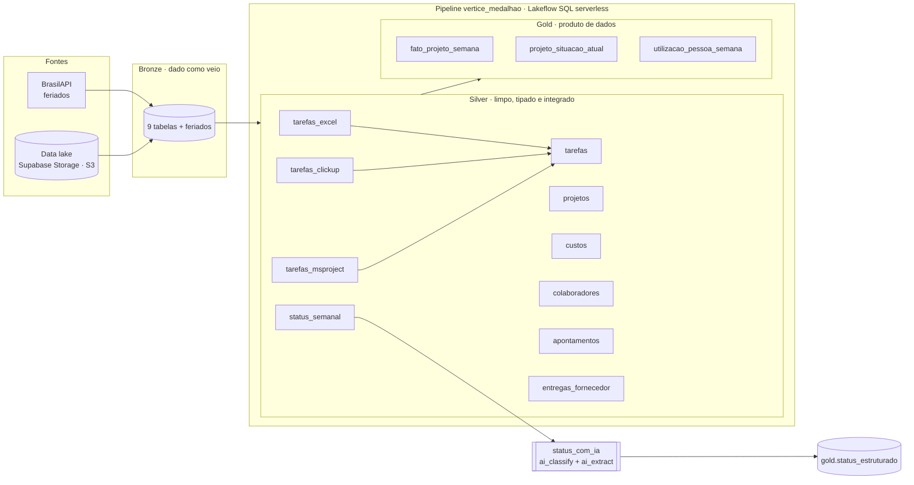
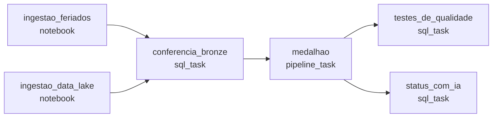

# Projeto Farol · Torre de Controle de Projetos

> Lakehouse em Databricks que integra o controle de projetos de **três ferramentas diferentes**
> (Excel, ClickUp e MS Project) num modelo único, calcula os indicadores de valor agregado
> (SPI, CPI, EAC) e usa IA generativa para transformar o status semanal dos gerentes em dados.


---

## Sumário

- [O problema](#o-problema)
- [O que foi entregue](#o-que-foi-entregue)
- [Arquitetura](#arquitetura)
- [Camadas de dados](#camadas-de-dados)
- [Qualidade de dados](#qualidade-de-dados)
- [Status semanal com IA](#status-semanal-com-ia)
- [Orquestração](#orquestração)
- [Resultados](#resultados)
- [Estrutura do repositório](#estrutura-do-repositório)
- [Como executar](#como-executar)
- [Decisões técnicas](#decisões-técnicas)
- [Próximos passos](#próximos-passos)
- [Créditos](#créditos)

---

## O problema

A **Vértice Tecnologia** (empresa fictícia) implanta sistemas para clientes de varejo, finanças,
saúde, logística e indústria: **60 projetos, 520 pessoas e R$ 305 mi de carteira**. Cada gerente
controla o projeto numa ferramenta: **20 em planilhas Excel, 25 no ClickUp e 15 no MS Project**.
Resultado: ninguém sabe dizer quais projetos estão atrasados.

O dono da empresa fez quatro perguntas:

| # | Pergunta | Como a Torre responde |
|---|---|---|
| 1 | Quais projetos estão atrasados, e de quais clientes? | SPI, CPI e situação por projeto (`gold.projeto_situacao_atual`) |
| 2 | Quanto esse atraso vai me custar? | EAC, estouro previsto e margem projetada |
| 3 | Tenho gente parada enquanto outro projeto pede gente? | Utilização do timesheet (`gold.utilizacao_pessoa_semana`) cruzada com a causa declarada no status (`gold.status_estruturado`) |
| 4 | O que vai dar errado no próximo mês? | Entregas de fornecedor em atraso e bloqueios recorrentes (modelo preditivo no [roadmap](#próximos-passos)) |

---

## O que foi entregue

| Componente | Descrição |
|---|---|
| **Pipeline medalhão** `vertice_medalhao` | Lakeflow Spark Declarative Pipelines em SQL, serverless: 7 tabelas silver e 3 gold, com regras de qualidade declaradas (`EXPECT ... ON VIOLATION FAIL UPDATE`) |
| **Integração das 3 ferramentas** | `silver.tarefas`: três visões com o mesmo contrato de colunas, empilhadas num modelo único (4.917 tarefas) |
| **Limpeza de 18 tipos de sujeira** | Datas em 3 formatos, vírgula decimal, linhas de TOTAL, tarefas-resumo, grafias diferentes, duplicidades e mais |
| **Indicadores de valor agregado** | PV, EV, AC, SPI, CPI, EAC, estouro, margem e atraso projetado, por projeto e por semana |
| **Status semanal estruturado com IA** | `ai_classify` + `ai_extract` (versão 2.0, schema tipado) com `MERGE` incremental: a IA nunca reprocessa um texto |
| **Conferência e testes** | Conferência da bronze antes do pipeline e 10 testes de negócio depois dele, que interrompem o job em caso de falha |
| **Job orquestrado** `vertice_farol` | 6 tarefas com dependências, agendado toda segunda às 6h (America/Sao_Paulo) |
| **Infraestrutura como código** | Tudo versionado e implantado com Declarative Automation Bundles (`databricks bundle deploy`) |

---

## Arquitetura



**Princípios:**

- **Declarativo:** cada arquivo diz *o que* a tabela é, não *como* orquestrar. O Lakeflow lê as dependências, monta o grafo e paraleliza.
- **A integração é um contrato de colunas:** cada ferramenta vira uma visão com as mesmas 13 colunas. Uma ferramenta nova seria só mais uma visão.
- **O de-para é dado, não código:** quem diz que a lista `901200023757` do ClickUp é o `PRJ-003` é o cadastro do PMO (`silver.projetos.codigo_ferramenta`).
- **Data de referência fixa:** todo cálculo usa `DATE'2026-10-16'` em vez de `current_date()`, para que os números sejam reproduzíveis.

---

## Camadas de dados

Catálogo Unity Catalog: **`lakehouse_vertice`**. O dicionário completo, coluna a coluna, está em
[docs/dicionario-de-dados.md](docs/dicionario-de-dados.md).

### Bronze

O dado bruto de cada fonte, com a sujeira original, recriado a cada ingestão.

| Tabela | Linhas | Origem |
|---|---:|---|
| `projetos` | 60 | Cadastro do PMO (CSV) |
| `status_semanal` | 3.911 | Status de toda sexta (CSV) |
| `excel_tarefas` | 1.663 | 20 planilhas Excel |
| `clickup_tarefas` | 2.119 | 25 listas do ClickUp (JSON) |
| `msproject_tarefas` | 1.260 | 15 cronogramas do MS Project (XML) |
| `colaboradores` | 523 | Cadastro de pessoas |
| `apontamentos` | 30.883 | Timesheet semanal |
| `custos` | 23.640 | Lançamentos de custo real |
| `entregas_fornecedor` | 640 | Entregas das consultorias |

### Silver

Sete tabelas, nem uma a mais. Arquivos em [src/silver/](src/silver/).

| Tabela | O que resolve |
|---|---|
| `projetos` | Datas em dois formatos, ferramenta escrita de 8 jeitos, código vazio |
| `tarefas` | **As três ferramentas num modelo só**, sem linha de TOTAL e sem tarefas-resumo |
| `status_semanal` | Farol em caixas diferentes, status vazio sinalizado e mantido |
| `custos` | Vírgula decimal convertida sem perda, estornos mantidos e sinalizados |
| `colaboradores` | Três pessoas duplicadas resolvidas |
| `apontamentos` | Semana alinhada à sexta-feira |
| `entregas_fornecedor` | A mesma consultoria com 4 grafias normalizada, prazos e atraso calculados |

### Gold

Uma tabela por pergunta do dono. Arquivos em [src/gold/](src/gold/) e [src/ia/](src/ia/).

| Tabela | Grão | Responde |
|---|---|---|
| `projeto_situacao_atual` | projeto (60) | Quais projetos estão atrasados e quanto vai custar |
| `fato_projeto_semana` | projeto × sexta-feira | O projeto está melhorando ou piorando? |
| `utilizacao_pessoa_semana` | pessoa × projeto × semana | Tem gente parada? |
| `status_estruturado` | projeto × status semanal | Por que atrasou, quem destrava e quanto custa em dias |

**De onde vem o histórico:** Excel, ClickUp e Project só guardam o percentual de *hoje*. O único
registro semana a semana é o status que o gerente publica toda sexta. Por isso o `fato_projeto_semana`
usa o percentual do status (preenchido para frente com `last_value(..., true)` quando o projeto
para de publicar), e a fotografia de hoje usa as tarefas das ferramentas.

### Indicadores

| KPI | Fórmula |
|---|---|
| PV (valor planejado) | orçamento × Σ(horas × fração do baseline decorrida) ÷ Σ horas |
| EV (valor agregado) | orçamento × Σ(horas × % concluído) ÷ Σ horas |
| AC (custo real) | Σ lançamentos até a data |
| SPI / CPI | EV ÷ PV / EV ÷ AC |
| EAC | orçamento ÷ CPI |
| Estouro previsto | max(EAC − orçamento, 0) |
| Margem projetada | (contrato − EAC) ÷ contrato |
| Atraso projetado | duração baseline ÷ SPI − duração baseline |
| Situação | `crítico` se SPI ou CPI < 0,8 · `atenção` se < 0,9 · `ok` |
| Melancia | farol do gerente verde com SPI < 0,9 (verde por fora, vermelho por dentro) |

---

## Qualidade de dados

A qualidade é verificada em três momentos, e qualquer falha interrompe o job antes de o dado errado
chegar ao consumo.

**1. Antes do pipeline: conferência da bronze** ([src/conferencia/00-conferencia-bronze.sql](src/conferencia/00-conferencia-bronze.sql))
Compara a contagem de cada uma das 9 tabelas com o esperado e chama `raise_error()` apontando
a tabela que divergiu.

**2. Dentro do pipeline: expectativas declarativas**

| Tabela | Regra |
|---|---|
| `silver.projetos` | `data_inicio IS NOT NULL` · `ferramenta IN ('excel','clickup','msproject')` |
| `silver.tarefas` | `achou_o_projeto` (nenhuma tarefa órfã) · `pct_entre_0_e_100` · `horas_positivas` |
| `silver.status_semanal` | `farol IN ('verde','amarelo','vermelho')` |
| `gold.fato_projeto_semana` | `pv >= 0` · `ev <= orcamento` |

Todas com `ON VIOLATION FAIL UPDATE`: a regra pertence à tabela, não ao script que rodou naquele dia.

**3. Depois do pipeline: 10 testes de negócio** ([src/testes/testes.sql](src/testes/testes.sql))

| # | Teste |
|---|---|
| 1 | Os 60 projetos têm cronograma em `silver.tarefas` |
| 2 | Cada projeto veio de uma única ferramenta, a do cadastro do PMO |
| 3 | As horas do Excel na silver batem com as linhas de TOTAL das planilhas |
| 4 | Uma linha por pessoa em `silver.colaboradores` |
| 5 | A CodeForge virou um fornecedor só |
| 6 | A limpeza não mudou o custo total (bronze = silver = R$ 193,35 mi) |
| 7 | Os 60 projetos têm fotografia de hoje |
| 8 | Todo projeto em andamento tem SPI e CPI |
| 9 | O EV de hoje pelo status semanal bate com o das ferramentas (diferença < 1%) |
| 10 | O AC de hoje no fato é igual à soma dos lançamentos até hoje |

### Sujeiras tratadas

| Sujeira | Onde | Tratamento |
|---|---|---|
| Data em `yyyy-MM-dd` e `dd/MM/yyyy` | `projetos` | `coalesce` de dois `try_to_date` |
| Ferramenta escrita de 8 jeitos | `projetos` | Normalização por `LIKE` |
| Código da ferramenta vazio | `projetos` | Excel: `PRJ-xxx` do nome do arquivo · ClickUp: nome da lista |
| Data do Excel como texto ou número de série | `excel_tarefas` | `dd/MM/yyyy` ou `date_add(DATE'1899-12-30', n)` |
| Percentual em `'45%'`, `'10,5%'` ou `0.45`, alguns acima de 100 | `excel_tarefas` | Conversão + `least(…, 100)` com flag `pct_veio_acima_de_100` |
| Linha de TOTAL no fim da planilha | `excel_tarefas` | Removida (e testada contra a silver) |
| Horas em `'40h'` e `'PT40H0M0S'` | Excel e Project | `replace` e `regexp_extract` |
| Datas em milissegundos, campos em `custom_fields` | `clickup_tarefas` | `timestamp_millis` e `filter(custom_fields, …)` |
| Status escrito de 12 jeitos | `clickup_tarefas` | `concluida`, `a_fazer`, `em_andamento` |
| Tarefas-resumo somando as horas de baixo | `msproject_tarefas` | `WHERE Summary = 0` |
| A fase não está na tarefa | `msproject_tarefas` | `last_value` da última tarefa-resumo de nível 1 |
| Vírgula decimal em 671 valores | `custos` | `replace` antes do `CAST` (nunca `try_cast`, que perderia R$ 5,4 mi em silêncio) |
| Estorno como valor negativo | `custos` | Mantido, com flag `estorno` |
| A mesma consultoria com 4 grafias | `entregas_fornecedor` | Normalizada, grafia original preservada |
| Pessoa cadastrada duas vezes | `colaboradores` | `row_number`, mantendo o cadastro em minúsculas |
| Farol `'Verde'`, `'VERDE'` | `status_semanal` | `lower(trim())` |
| Status vazio (`''`, `N/A`, `ver ata da reunião`) | `status_semanal` | Mantido, com flag `status_vazio` |

---

## Status semanal com IA

O gerente escreve o status em texto livre. A tarefa `status_com_ia`
([src/ia/status_estruturado.sql](src/ia/status_estruturado.sql)) transforma esse texto em colunas:
causa do bloqueio, o que bloqueia, quem destrava e dias de impacto.

A IA custa cerca de um segundo por texto e não pode ser refeita toda semana. Por isso cada status
passa pelo método mais barato que resolve:

| Método | Quando | Como | Status |
|---|---|---|---:|
| `regra` | Status vazio ou "sem bloqueios" | Classificação direta | 2.954 |
| `ia` | Últimos 90 dias, com bloqueio | `ai_classify` (8 causas) + `ai_extract` com JSON schema tipado | 163 |
| `palavra_chave` | Histórico mais antigo | `RLIKE` no trecho de bloqueios | 794 |

A tabela é **incremental**: `CREATE TABLE IF NOT EXISTS` + `MERGE ... WHEN NOT MATCHED` com
`LEFT ANTI JOIN`. Cada execução só classifica os status novos da semana.

Exemplo de saída da IA:

| projeto | data | causa | bloqueio (extraído) | quem destrava | dias |
|---|---|---|---|---|---:|
| PRJ-001 | 31/07/2026 | `aprovacao_cliente` | Aguardando aprovação do cliente para seguir com migração dos dados de produção | Cliente | 0 |
| PRJ-011 | 16/10/2026 | `falta_sre` | Sem SRE alocado: pipeline de deploy quebrado e ninguém para corrigir | SRE | 8 |

Somados os últimos 90 dias, o PRJ-011 tem 12 semanas com `falta_sre` e 57 dias de impacto declarado.

---

## Orquestração

Job **`vertice_farol`** ([resources/vertice.job.yml](resources/vertice.job.yml)), toda segunda às 6h:



| # | Tarefa | Tipo | O que faz |
|---|---|---|---|
| 1 | `ingestao_feriados` | Notebook serverless | Grava `bronze.feriados` a partir da BrasilAPI |
| 2 | `ingestao_data_lake` | Notebook serverless | Baixa os arquivos do data lake (S3/boto3) e recria as 9 tabelas bronze |
| 3 | `conferencia_bronze` | SQL task | Confere a contagem das 9 tabelas |
| 4 | `medalhao` | Pipeline task | Atualiza silver (7) e gold (3) |
| 5 | `testes_de_qualidade` | SQL task | Executa os 10 testes de negócio |
| 6 | `status_com_ia` | SQL task | Classifica os status novos |

- `max_concurrent_runs: 1`: duas execuções simultâneas apagariam a bronze uma da outra.
- No target `dev`, o agendamento é implantado **pausado** (`presets.trigger_pause_status`).
- As credenciais do data lake são variáveis do bundle e nunca entram no repositório (ver [Segurança](#segurança)).

---

## Resultados

Execução de referência, com a data de corte de 16/10/2026:

| Indicador | Valor |
|---|---|
| Tarefas integradas | **4.917**: Excel 1.643 (20 projetos) · ClickUp 2.119 (25) · MS Project 1.155 (15) |
| Projetos em andamento / concluídos | 41 / 19 |
| Projetos **críticos** / em **atenção** | **7** / **10** |
| **Estouro previsto** (em andamento) | **R$ 6,47 mi** |
| SPI da carteira | 0,92 |
| **Melancias** (farol verde, SPI < 0,9) | 4: PRJ-012, PRJ-028, PRJ-034, PRJ-042 |
| Custo real total (antes e depois da limpeza) | R$ 193,35 mi |
| Entregas de fornecedor em atraso | 5, todas da CodeForge |
| Pessoas ociosas | 2 SREs seniores no PRJ-007 com 5,5% e 5,8% de utilização, mais de 450 h paradas cada em 12 semanas |
| Causa no PRJ-011 | Falta de SRE em 12 semanas, 57 dias de impacto declarado |

A pergunta 3 do dono tem resposta direta: **há SREs parados no PRJ-007 enquanto o PRJ-011 reporta
falta de SRE há 12 semanas.**

**Tempo de execução** (Databricks Free Edition, serverless):

| Tarefa | Tempo |
|---|---:|
| `conferencia_bronze` | 4 s |
| `medalhao` (silver + gold) | ~1 min 40 s |
| `testes_de_qualidade` | ~20 s |
| `status_com_ia` (primeira carga, 163 textos) | 2 min 38 s |

---

## Estrutura do repositório

```
.
├── databricks.yml                      # bundle "vertice": variáveis, targets dev/prod
├── resources/
│   ├── vertice.job.yml                 # job vertice_farol (6 tarefas, agendamento)
│   └── vertice_medalhao.pipeline.yml   # pipeline declarativo silver + gold
├── src/
│   ├── conferencia/                    # conferência da bronze
│   ├── silver/                         # 01-projetos ... 05-fornecedores
│   ├── gold/                           # fato semanal, situação atual, utilização
│   ├── ia/                             # status estruturado com IA (MERGE incremental)
│   └── testes/                         # 10 testes de negócio
├── scripts/run_sql.py                  # executa SQL pela API de statements
├── docs/dicionario-de-dados.md         # dicionário das tabelas silver e gold
├── llm/                                # prompts usados na construção
└── CLAUDE.md                           # contexto do projeto (regras de negócio)
```

---

## Como executar

### Pré-requisitos

- Workspace Databricks com Unity Catalog e serverless (testado no **Free Edition**)
- [Databricks CLI](https://docs.databricks.com/dev-tools/cli/install.html) ≥ 1.20
- Catálogo `lakehouse_vertice` com os schemas `bronze`, `silver` e `gold`
- Um SQL warehouse (o Free Edition tem o *Serverless Starter Warehouse*)

### 1. Autenticar

```bash
databricks auth login --host https://<seu-workspace>.cloud.databricks.com --profile DEFAULT
```

### 2. Configurar as variáveis

Em [databricks.yml](databricks.yml), ajuste `catalog` e `warehouse_id`. As credenciais do data lake
ficam em `.databricks/bundle/dev/variable-overrides.json`, que está no `.gitignore`:

```json
{
  "s3_endpoint": "https://<projeto>.storage.supabase.co/storage/v1/s3",
  "s3_region": "us-east-1",
  "s3_bucket": "<bucket>",
  "s3_raw": "/Volumes/lakehouse_vertice/raw/s3",
  "s3_access_key": "<access-key>",
  "s3_secret_key": "<secret-key>"
}
```

Os caminhos dos notebooks de ingestão em [resources/vertice.job.yml](resources/vertice.job.yml)
apontam para o workspace do autor e precisam ser ajustados para o seu.

### 3. Validar, implantar e executar

```bash
databricks bundle validate --profile DEFAULT
databricks bundle deploy   --profile DEFAULT

# job completo
databricks bundle run vertice_farol --profile DEFAULT

# só a transformação e o que vem depois (bronze já carregada)
databricks bundle run vertice_farol --only medalhao+ --profile DEFAULT
```

### 4. Conferir

```sql
SELECT situacao, COUNT(*) AS projetos,
       ROUND(SUM(estouro_previsto) / 1e6, 2) AS estouro_mi,
       COUNT_IF(melancia) AS melancias
FROM lakehouse_vertice.gold.projeto_situacao_atual
GROUP BY situacao;
-- crítico 7 · atenção 10 (4 melancias) · ok 24 · concluído 19
```

### Segurança

- **Nenhuma credencial é versionada.** As chaves do data lake são variáveis do bundle sem valor
  padrão. O valor fica em `variable-overrides.json`, dentro de `.databricks/`, ignorado pelo Git.
- O alvo `prod` usa `mode: production` com caminho de implantação fixo e permissão `CAN_MANAGE`
  restrita ao dono.

---

## Decisões técnicas

| Decisão | Motivo |
|---|---|
| Materialized views em vez de streaming tables | A bronze é recriada por completo a cada ingestão: as fontes são snapshots, não fluxos |
| Visões temporárias para cada ferramenta | Lógica intermediária que não precisa ser publicada no catálogo; o grafo do pipeline mostra a integração |
| `replace` antes do `CAST`, nunca `try_cast` | `try_cast` devolve NULL em silêncio. Aqui ele descartaria 671 lançamentos (R$ 5,4 mi) |
| Janela num CTE e agregação no seguinte | Função de janela dentro de agregação falha no pipeline |
| Testes como `sql_task` com `raise_error()` | O job para antes de o dado errado chegar ao consumo |
| IA apenas nos últimos 90 dias | Custo e latência: 163 chamadas em vez de 3.911, com regra e palavra-chave no restante |
| Tabela de IA fora do pipeline | Precisa acumular entre execuções; uma materialized view recalcularia tudo |
| Sem `mode: development` no dev | O modo prefixa os nomes dos recursos com `[dev usuario]` |

---

## Próximos passos

Os itens abaixo estão desenhados, mas **ainda não implementados**.

### Dashboard AI/BI "Projeto Farol · Portfólio"

Dashboard como código: `scripts/gerar_dashboard.py` gera o JSON (`GRID_V1`), implantado como recurso
do bundle (`resources/dashboard.dashboard.yml`).

| Página | Conteúdo |
|---|---|
| Portfólio | KPIs da carteira (contrato, SPI, CPI, estouro, em risco, críticos, melancias) · estouro por projeto colorido por situação · dispersão SPI × CPI · SPI e CPI semanais · farol do gerente × farol calculado |
| Pessoas | Top 15 por custo da hora parada · utilização por pessoa e projeto · causas de bloqueio por projeto |
| Fornecedores | Prazo real ÷ prometido e % no prazo por fornecedor · entregas em atraso hoje |

### App "Projeto Farol" (Databricks Apps)

Aplicação AppKit (Node/TypeScript/React) em bundle próprio, lendo a gold pelo SQL warehouse.

- **Projetos em risco:** KPIs e tabela com situação, farol do gerente com marcação de melancia e probabilidade de estouro.
- **Simulador de realocação:** escolhe uma pessoa ociosa e um projeto em risco e calcula horas no mês, ociosidade evitada, dias de cronograma recuperados, custo de mobilização e saldo.
- **Perguntar:** um Genie Space ("Farol · Diretoria") para o dono consultar os dados em português.

### Modelo preditivo de estouro em 30 dias

`gold.score_estouro_30d`: features semanais no schema `ml`, classificador com MLflow e Unity Catalog
e score com faixa de risco, para responder à pergunta 4 com antecedência.

### Métrica governada

Metric view `gold.mv_projetos` com as definições oficiais de SPI, CPI e estouro, para que dashboard,
Genie e app usem a mesma fórmula.

---

## Créditos

Projeto desenvolvido durante a **Imersão Jornada de Dados** (outubro de 2026), a partir do caso
e do dataset sintético (seed 42) da Vértice Tecnologia. A construção foi feita com o Claude Code; os
prompts estão em [llm/](llm/) e o contexto de negócio em [CLAUDE.md](CLAUDE.md).
