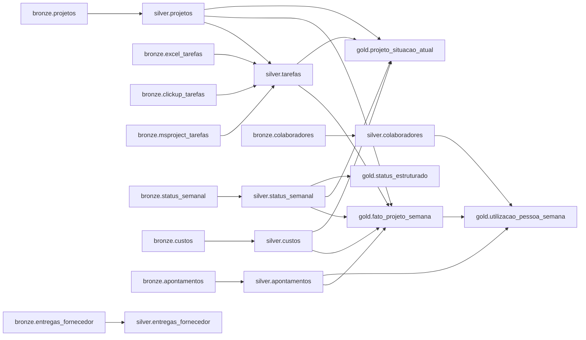

# Dicionário de dados

Catálogo **`lakehouse_vertice`** (Unity Catalog). Data de referência de todos os cálculos:
**16/10/2026** (`DATE'2026-10-16'`). Convenções: snake_case em português; datas como `DATE`;
semanas identificadas pela **sexta-feira**; percentuais de 0 a 100; razões (SPI, CPI,
utilização, margem) como fração com 4 casas.

- [Silver](#silver): [projetos](#silverprojetos) · [tarefas](#silvertarefas) · [status_semanal](#silverstatus_semanal) · [custos](#silvercustos) · [colaboradores](#silvercolaboradores) · [apontamentos](#silverapontamentos) · [entregas_fornecedor](#silverentregas_fornecedor)
- [Gold](#gold): [projeto_situacao_atual](#goldprojeto_situacao_atual) · [fato_projeto_semana](#goldfato_projeto_semana) · [utilizacao_pessoa_semana](#goldutilizacao_pessoa_semana) · [status_estruturado](#goldstatus_estruturado)
- [Linhagem](#linhagem)

---

## Silver

Materialized views do pipeline `vertice_medalhao`, lidas da bronze. Código em [src/silver/](../src/silver/).

### silver.projetos

Cadastro do PMO e **de-para da integração**: liga cada projeto ao seu código na ferramenta.
Grão: projeto · 60 linhas.

| Coluna | Tipo | Descrição |
|---|---|---|
| `projeto_id` | STRING | Identificador do projeto (`PRJ-001` a `PRJ-060`) |
| `nome_projeto` | STRING | Nome do projeto |
| `cliente` | STRING | Cliente contratante |
| `segmento` | STRING | Segmento do cliente (varejo, financeiro, saúde, logística, indústria) |
| `tipo_projeto` | STRING | Tipo de projeto |
| `ferramenta` | STRING | Ferramenta normalizada: `excel`, `clickup` ou `msproject` |
| `ferramenta_como_veio` | STRING | Grafia original da ferramenta no cadastro |
| `codigo_ferramenta` | STRING | Arquivo (Excel, Project) ou `list_id` (ClickUp); NULL quando vazio |
| `valor_contrato` | DECIMAL(18,2) | Valor do contrato (R$) |
| `orcamento_custo` | DECIMAL(18,2) | Orçamento de custo (R$) |
| `data_inicio` | DATE | Início do projeto (unificado de dois formatos) |
| `data_fim_baseline` | DATE | Término previsto no baseline |
| `status` | STRING | `em_andamento` ou `concluido` |
| `gerente_projeto` | STRING | Gerente responsável |

**Expectativas:** `data_inicio IS NOT NULL`, `ferramenta IN ('excel','clickup','msproject')`.

### silver.tarefas

**As três ferramentas num modelo só.** Excel, ClickUp e MS Project são convertidos para o mesmo
contrato de colunas e empilhados. Não contém linhas de TOTAL nem tarefas-resumo.
Grão: tarefa · 4.917 linhas.

| Coluna | Tipo | Descrição |
|---|---|---|
| `tarefa_id` | STRING | Chave única: `projeto-ferramenta-id` |
| `projeto_id` | STRING | Projeto, pelo de-para do cadastro (com fallback pelo nome do arquivo ou da lista) |
| `ferramenta` | STRING | `excel`, `clickup` ou `msproject` |
| `id_na_ferramenta` | STRING | Identificador original da tarefa na ferramenta |
| `fase` | STRING | Fase do projeto (no Project, derivada da hierarquia) |
| `tarefa` | STRING | Nome da tarefa |
| `responsavel` | STRING | Responsável (NULL no Project) |
| `inicio_baseline` | DATE | Início previsto |
| `fim_baseline` | DATE | Término previsto |
| `inicio_real` | DATE | Início real |
| `fim_real` | DATE | Término real |
| `pct_concluido` | DOUBLE | Percentual concluído, limitado a 100 |
| `pct_veio_acima_de_100` | BOOLEAN | O percentual original passava de 100 |
| `pct_como_veio` | DOUBLE | Percentual após conversão, antes do limite |
| `horas` | DOUBLE | Horas previstas |
| `status_na_ferramenta` | STRING | ClickUp: `concluida`, `a_fazer`, `em_andamento` (NULL nas demais) |

**Expectativas:** `achou_o_projeto` (`projeto_id IS NOT NULL`), `pct_entre_0_e_100`, `horas_positivas`.

### silver.status_semanal

Status publicado pelo gerente toda sexta-feira. Grão: projeto × sexta · 3.911 linhas.

| Coluna | Tipo | Descrição |
|---|---|---|
| `projeto_id` | STRING | Projeto |
| `data_status` | DATE | Sexta-feira do status |
| `gerente` | STRING | Gerente que publicou |
| `farol` | STRING | `verde`, `amarelo` ou `vermelho` |
| `pct_concluido` | INT | Percentual concluído declarado |
| `texto_status` | STRING | Texto livre com entregas e bloqueios |
| `status_vazio` | BOOLEAN | Texto sem conteúdo (`''`, `N/A`, `ver ata da reunião`); a linha é mantida |

**Expectativa:** `farol IN ('verde','amarelo','vermelho')`.

### silver.custos

Lançamentos de custo real. O valor é **líquido**: estornos permanecem como valores negativos.
Grão: lançamento · 23.640 linhas · total R$ 193,35 mi.

| Coluna | Tipo | Descrição |
|---|---|---|
| `lancamento_id` | STRING | Identificador do lançamento |
| `projeto_id` | STRING | Projeto |
| `data` | DATE | Data do lançamento |
| `semana` | DATE | Sexta-feira da semana do lançamento |
| `categoria` | STRING | Pessoal, consultoria, cloud, licenças, despesas |
| `descricao` | STRING | Descrição |
| `valor` | DECIMAL(18,2) | Valor (R$), com a vírgula decimal convertida sem perda |
| `estorno` | BOOLEAN | Valor negativo |
| `centro_custo` | STRING | Centro de custo |

### silver.colaboradores

Uma linha por pessoa (três cadastros duplicados resolvidos). Grão: colaborador · 520 linhas.

| Coluna | Tipo | Descrição |
|---|---|---|
| `colaborador_id` | STRING | Identificador (`COL0001` ...) |
| `nome` | STRING | Nome |
| `papel` | STRING | Papel (dev, qa, sre, product_owner, ...) |
| `senioridade` | STRING | Senioridade |
| `custo_hora` | DECIMAL(10,2) | Custo por hora (R$) |
| `data_admissao` | DATE | Admissão |
| `data_desligamento` | DATE | Desligamento (NULL = ativo) |

### silver.apontamentos

Timesheet semanal. Grão: colaborador × projeto × semana · 30.883 linhas.

| Coluna | Tipo | Descrição |
|---|---|---|
| `colaborador_id` | STRING | Pessoa |
| `projeto_id` | STRING | Projeto |
| `semana_inicio` | DATE | Segunda-feira da semana |
| `semana` | DATE | Sexta-feira da semana (chave comum com status e custos) |
| `horas_disponiveis` | DOUBLE | Horas disponíveis |
| `horas_apontadas` | DOUBLE | Horas apontadas |

### silver.entregas_fornecedor

Entregas das consultorias contratadas. Grão: entrega · 640 linhas.

| Coluna | Tipo | Descrição |
|---|---|---|
| `entrega_id` | STRING | Identificador |
| `projeto_id` | STRING | Projeto |
| `fornecedor` | STRING | Fornecedor normalizado |
| `fornecedor_como_veio` | STRING | Grafia original |
| `item` | STRING | Item entregue |
| `valor` | DECIMAL(18,2) | Valor (R$) |
| `data_pedido` | DATE | Data do pedido |
| `data_prometida` | DATE | Data prometida |
| `data_entrega` | DATE | Data de entrega (NULL = em aberto) |
| `prazo_contratado_dias` | INT | Prazo em contrato |
| `status` | STRING | Status informado |
| `prazo_prometido_dias` | INT | Dias entre pedido e data prometida |
| `prazo_real_dias` | INT | Dias entre pedido e entrega |
| `dias_de_atraso_na_entrega` | INT | Dias entre a data prometida e a entrega |
| `em_aberto` | BOOLEAN | Ainda não entregue |
| `em_atraso` | BOOLEAN | Em aberto com a data prometida antes de 16/10/2026 |

---

## Gold

Código em [src/gold/](../src/gold/) (pipeline) e [src/ia/](../src/ia/) (tarefa incremental).

### gold.projeto_situacao_atual

Fotografia de cada projeto em 16/10/2026, com o cadastro e os indicadores calculados sobre as
tarefas das ferramentas. Grão: projeto · 60 linhas.

| Coluna | Tipo | Descrição |
|---|---|---|
| `projeto` | STRING | Rótulo `PRJ-xxx · nome` |
| `projeto_id` | STRING | Projeto |
| `nome_projeto`, `cliente`, `segmento`, `tipo_projeto`, `ferramenta`, `gerente_projeto` | STRING | Cadastro |
| `valor_contrato` | DOUBLE | Valor do contrato (R$) |
| `orcamento` | DOUBLE | Orçamento de custo (R$) |
| `data_inicio`, `data_fim_baseline` | DATE | Início e término previstos |
| `duracao_baseline_dias` | INT | Duração prevista em dias |
| `status` | STRING | `em_andamento` ou `concluido` |
| `pv` | DOUBLE | Valor planejado até hoje (R$) |
| `ev` | DOUBLE | Valor agregado até hoje (R$) |
| `ac` | DECIMAL | Custo real até hoje (R$) |
| `spi` | DOUBLE | EV ÷ PV (< 1 = atraso) |
| `cpi` | DOUBLE | EV ÷ AC (< 1 = estouro) |
| `eac` | DOUBLE | Custo estimado no término: orçamento ÷ CPI |
| `estouro_previsto` | DOUBLE | max(EAC − orçamento, 0) |
| `margem_projetada` | DOUBLE | (contrato − EAC) ÷ contrato |
| `atraso_projetado_dias` | DOUBLE | duração ÷ SPI − duração |
| `termino_projetado` | DATE | Início + duração ÷ SPI |
| `situacao` | STRING | `concluído`, `crítico` (SPI ou CPI < 0,8), `atenção` (< 0,9) ou `ok` |
| `farol_do_gerente` | STRING | Farol publicado em 16/10/2026 (NULL para concluídos) |
| `farol_calculado` | STRING | Pelo SPI: `verde` ≥ 0,95, `amarelo` ≥ 0,90, `vermelho` abaixo |
| `melancia` | BOOLEAN | Em andamento, farol do gerente verde e SPI < 0,9 |

### gold.fato_projeto_semana

Evolução semanal de cada projeto, do início até 16/10/2026. **PV, EV e AC são acumulados**: não
some semanas diferentes do mesmo projeto. Grão: projeto × sexta-feira.

| Coluna | Tipo | Descrição |
|---|---|---|
| `projeto_id` | STRING | Projeto |
| `semana` | DATE | Sexta-feira |
| `orcamento` | DOUBLE | Orçamento de custo (R$) |
| `pv` | DOUBLE | Valor planejado acumulado (pelo baseline das tarefas) |
| `ev` | DOUBLE | Valor agregado acumulado (pelo % do status semanal, preenchido para frente) |
| `ac` | DECIMAL | Custo real acumulado até a sexta |
| `spi`, `cpi`, `eac` | DOUBLE | Índices da semana |
| `farol_do_gerente` | STRING | Último farol publicado até a semana |
| `horas_disponiveis`, `horas_apontadas`, `horas_ociosas` | DOUBLE | Timesheet da semana (não acumulado) |

**Expectativas:** `pv >= 0`, `ev <= orcamento`.

### gold.utilizacao_pessoa_semana

Utilização do timesheet. Grão: colaborador × projeto × semana.

| Coluna | Tipo | Descrição |
|---|---|---|
| `colaborador_id`, `nome`, `papel`, `senioridade` | STRING | Pessoa |
| `projeto_id` | STRING | Projeto |
| `semana` | DATE | Sexta-feira |
| `horas_disponiveis`, `horas_apontadas` | DOUBLE | Horas da semana |
| `horas_ociosas` | DOUBLE | max(disponíveis − apontadas, 0) |
| `utilizacao` | DOUBLE | apontadas ÷ disponíveis |
| `custo_ocioso` | DOUBLE | horas ociosas × custo por hora (R$) |
| `spi_do_projeto` | DOUBLE | SPI do projeto na mesma semana |

### gold.status_estruturado

O texto livre do status semanal em colunas. Tabela **incremental** (fora do pipeline): cada
execução só acrescenta os status novos. Grão: projeto × sexta · 3.911 linhas.

| Coluna | Tipo | Descrição |
|---|---|---|
| `projeto_id` | STRING | Projeto |
| `data_status` | DATE | Sexta-feira do status |
| `farol` | STRING | Farol informado |
| `causa_bloqueio` | STRING | `change_freeze`, `falta_sre`, `dependencia_fornecedor`, `rotatividade`, `mudanca_escopo`, `bug_retrabalho`, `aprovacao_cliente`, `sem_bloqueio`, `nao_reportado` ou `outro` |
| `bloqueio` | STRING | O bloqueio descrito (método `ia`) |
| `quem_destrava` | STRING | Quem pode destravar (método `ia`) |
| `dias_impacto` | DOUBLE | Dias de impacto declarados (1 semana = 7) |
| `metodo` | STRING | `regra`, `ia` ou `palavra_chave` |
| `texto_status` | STRING | Texto original |
| `_classificado_em` | TIMESTAMP | Momento da classificação |

---

## Linhagem

